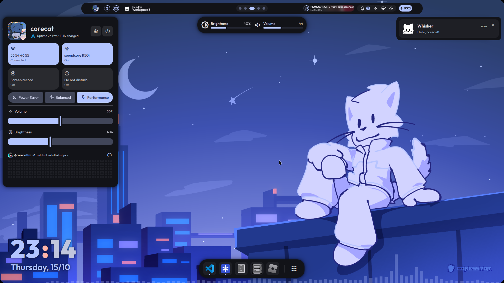
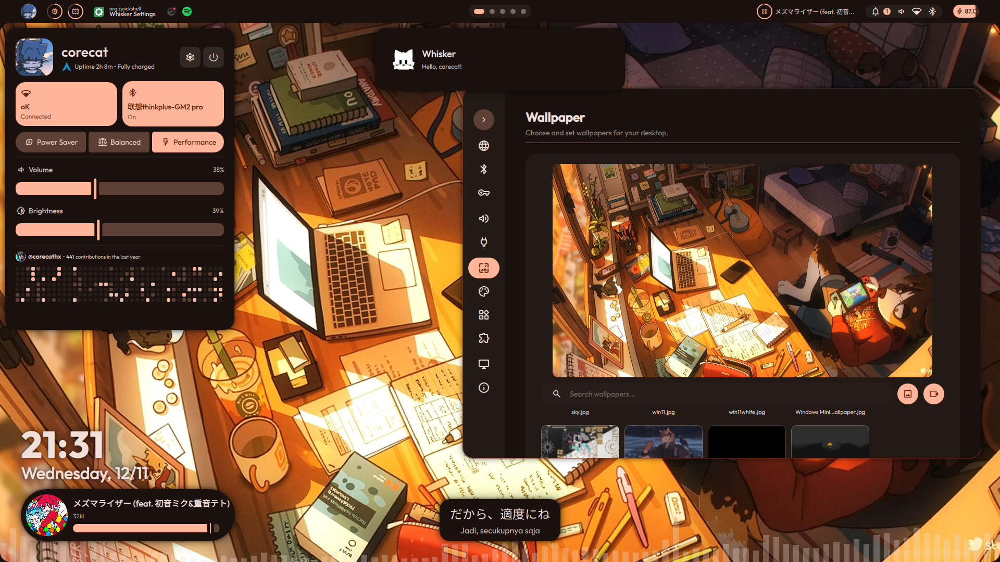
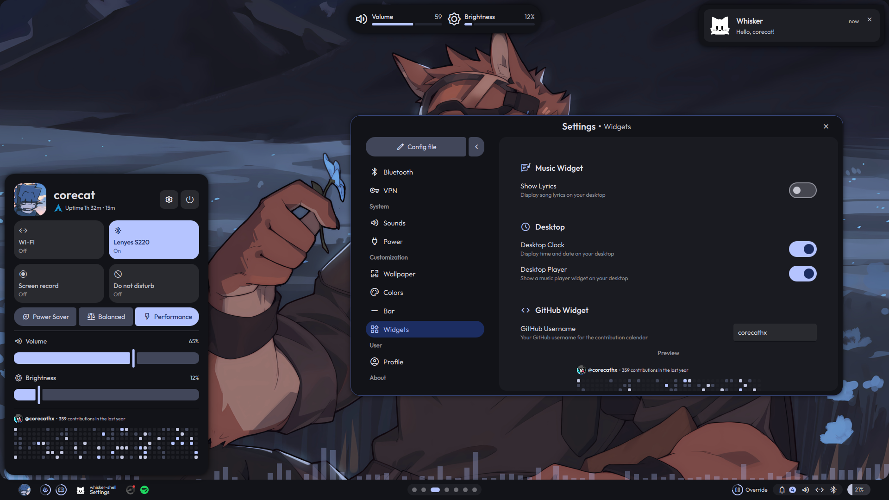
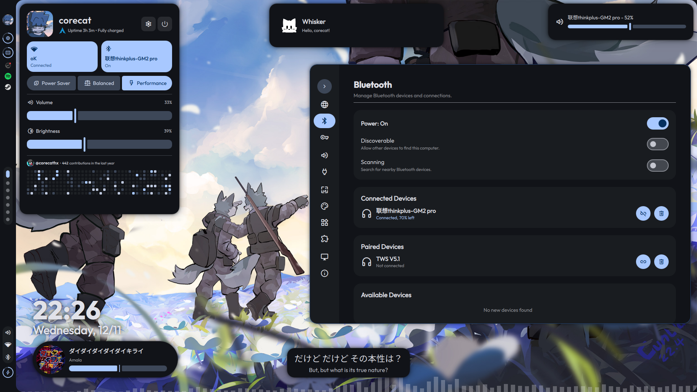
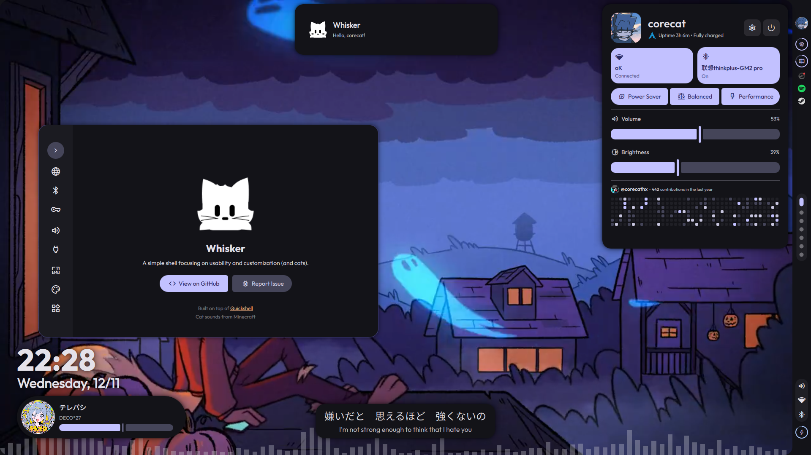
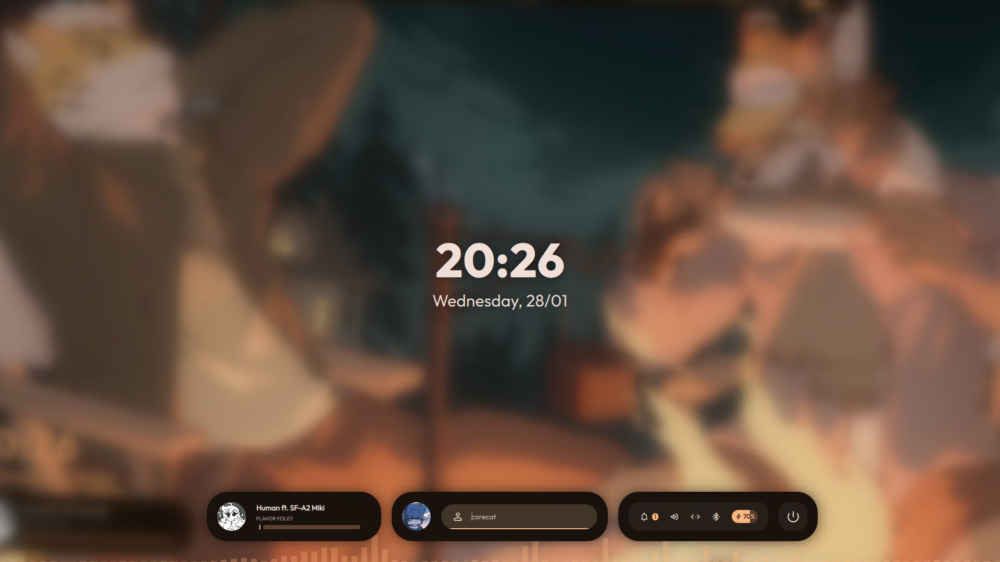
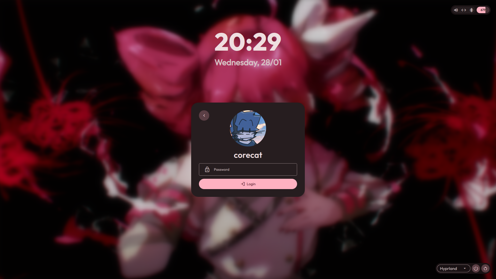

<div align="center">
    
    
</div>

<h2></h2>
<div align="center">

<br>


</div>

https://github.com/user-attachments/assets/88067bf2-e1c1-48cd-88d0-180a68f07d9d

<p align="center">
  A Desktop Shell for <b><a href="https://hyprland.org"> Hyprland</a></b>, prioritizing usability (and cats).<br>
  Built on top of <b><a href="https://quickshell.org"> Quickshell</a></b>.
</p>

<div align="center">
  <h2>✦ Features ✦</h2>
</div>

- Customizable desktop bar (top, bottom, left, and right).
- Dock and application launcher.
- Quick panel for common system controls.
- Wallpaper and color scheme customization.
- Audio controls and media player integration.
- Notifications and on-screen displays.
- Clipboard history and emoji picker.
- Lock screen and authentication prompts.
- Screenshot utility.


<div align="center">
  <h2>✦ Installation ✦</h2>
</div>

<details>
  <summary><b>Arch Linux</b></summary>

  <br>

  Whisker is available on the AUR. Install it using your preferred AUR helper.

  ```bash
  paru -S whisker-shell-git
  ```

  Once installed, run the shell with:

  ```bash
  whisker shell
  ```

</details>

<details>
  <summary><b>Manual Installation</b></summary>

  <br>

  Clone the repository:

  ```bash
  git clone https://github.com/corecathx/whisker
  cd whisker
  ```

  Then launch Whisker directly using Quickshell:

  ```bash
  qs -p .
  ```

> [!NOTE]
> Whisker may not work properly without [whisker-cli](https://github.com/corecathx/whisker-cli), which provides additional functionality used by the shell.
</details>


<div align="center">
  <h2>✦ Previews ✦</h2>
</div>

<table align="center">
  <tbody>
    <tr>
      <td colspan="2" align="center">
        <br>
        <b>Default Configuration</b>
      </td>
    </tr>
  </tbody>
</table>

<div align="center">
  <h2>✦ Bar Layouts ✦</h2>
</div>

<table align="center">
  <tbody>
    <tr>
      <td align="center">
        <br>
        <b>Default Layout (Top Bar)</b>
      </td>
      <td align="center">
        <br>
        <b>Alternative Layout (Bottom Bar)</b>
      </td>
    </tr>
    <tr>
      <td colspan="2" align="center">
        <br>
        These left and right bar modes are still experimental!
        <br><br>
      </td>
    </tr>
    <tr>
      <td align="center">
        <br>
        <b>Left Bar Layout (Experimental)</b>
      </td>
      <td align="center">
        <br>
        <b>Right Bar Layout (Experimental)</b>
      </td>
    </tr>
  </tbody>
</table>

<div align="center">
  <h2>✦ System Screens ✦</h2>
</div>

<table align="center">
  <tbody>
    <tr>
      <td align="center">
        <br>
        <b>Lockscreen</b>
      </td>
      <td align="center">
        <br>
        <b>Greeter</b>
      </td>
    </tr>
  </tbody>
</table>

<div align="center">
  <h2>✦ Related Projects ✦</h2>
</div>

### ✦ whisker-cli

`whisker-cli` is a small helper program for my Hyprland Shell, **Whisker**.

> https://github.com/corecathx/whisker-cli

<div align="center">
    <h2>✦ Credits & License ✦</h2>
</div>

This shell is **heavily** inspired by  
- **[caelestia-shell](https://github.com/caelestia-dots/shell)** by [soramanew](https://github.com/soramanew)  
- **[illogical-impulse](https://github.com/end-4/illogical-impulse)** by [end-4](https://github.com/end-4).

Big thanks to the **Quickshell** community with all the help they provided when I'm developing this shell <3

---

**Whisker** is licensed under the [GNU General Public License v3.0](../LICENSE).

* **Copying:** The license allows you to, just make sure to keep it open source and credit if used ;)
